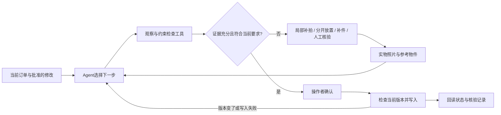

# 最终单选方案：KitGuard 备料核验与补件 AI Agent

研究日期：2026-09-26，韩国时间。面向昌原大学人工智能融合工程博士参赛者。

**最终选择 KitGuard。它在订单改版和照片证据不足时，主动指导重新取证、纠正备料，再核验工单状态。** 本文替代上一轮“校园材料助手优先”的初筛建议；以前的报告保留为研究记录。

资源已于9月26日补充确认：MacBook Pro M5 Pro / 64 GB；台式机 i9-9900KF、RTX 3080 / 10 GB、内存32 GB；Codex Pro 20x。已确认两人队해피：队长남청청（硕博连读一年级），队员이개심（博士一年级），均为国立昌原大学인공지능융합공학과。Codex承担软件开发辅助，两位参赛者负责实物实验、结果核查和参赛责任。尚未确认工厂合作或测试参与者。它争取大奖的依据是可见的实物任务、可检查的工具执行及公平实验，而非题目名称本身。第一名不能保证；详细评分尚待说明会公开，当前也没有原型或测试结果。

## 1. 报名定位

| 项目 | 最终建议 |
|---|---|
| 中文名 | KitGuard：订单变更下的备料核验与补件 Agent |
| 韩文暂定名 | 키트가드 — 작업지시 변경과 실물 재검증을 연결하는 키팅 AI Agent |
| 组别 | 一般部（博士） |
| 建议主题 | ② 업무혁신·생산성 향상 AI Agent（业务创新与生产率提升） |
| 具体业务 | 制造备料/装配前套件复核，先用桌面实物实验验证 |
| 目标用户 | 经常更换订单、小批量配套的操作人员；赛期先邀请同学执行配料任务 |
| 核心交付 | 一条能完成“下单—核验—补件—复核—记录”的运行流程及评测证据 |

选择主题②，是因为目前可承诺的成果是人工备料工作的软件辅助与执行核验。主办方[报名说明](https://contest.gnict.org/apply.php)将其列为独立主题，并将博士归一般部；制造/VR大学指定课题另列。本文不假定你已获 ANCHOR 资助或满足某大学子课题的额外要求。9月29日若正式题目有变，按公布要求调整归类和表述。

## 2. 一句话说清价值

**“订单变了、零件少了、照片看不清时，AI知道该补查什么；纠正以后，重新核验实际物料和当前订单，再记录结果。”**

备料（kitting）就是把一份订单需要的不同零件配成一套。本项目解决的窄问题是：已经检查过的一套物料，是否仍符合当前订单；证据不够时，如何取得足够的信息完成检查。

### 一段可现场运行的故事

1. 订单 R1 要求：螺栓2、螺母2、垫圈2、角码1。操作者按要求配料。
2. 上传一条经负责人确认的 R2 修改：“垫圈改为3个，其余不变。” Agent 将修改转换成结构化差异，R1 的旧检查不再有效。
3. 新照片里两只垫圈叠在一起。系统保留“可见数量不能确定”，要求“把右上格的垫圈分开，每格一件，再拍这一块”。
4. 分开后确认只有2只，系统指出还缺1只，建立补件任务。
5. 人真实加上1只，重新拍摄；工具核对当前R2需求，记录图片和结果。
6. 操作者确认实验工单完成。写入前再次检查订单版本，写入后回读记录。如果期间版本又变了，保持待复核，不显示假成功。

人负责移动实物和最终确认；Agent负责判断下一步、调用工具、管理证据及结果。系统不驱动机器人或实际生产设备。

## 3. 查重之后，还剩什么值得做

| 已有能力 | 一手来源 | 本项目需要证明的剩余价值 |
|---|---|---|
| 视觉识别套件部件、核对BOM、保存照片并允许发货 | [Tulip / Laerdal案例](https://tulip.co/case-studies/laerdal-medical/) | 在本次有限场景中，新订单和不完整证据下的主动核验是否有效 |
| 备料库存/需求/重复检查、工单和谱系记录 | [Tulip Kitting](https://support.tulip.co/docs/kitting) | 自然语言变化转成约束、主动补证和写入结果验证的组合效果 |
| 实物数量、订单清单和追溯记录核对 | [Roboflow Kitting](https://roboflow.com/ai/kitting-verification) | 无专用训练的原型可行性；总成本与商用差距尚未比较 |
| 用视觉工具放大图像、检索参考样本、反复检查异常 | [AgentIAD](https://arxiv.org/abs/2512.13671)、[IndusAgent](https://arxiv.org/abs/2605.20682) | 真实物件被移动/补充后，新的取证动作是否改善完整任务结果 |

**不能声称全球首创视觉备料、首次打通闭环、比商用更便宜或精度更高。** 厂商公开资料足以否定这些过强宣传；其网页未写某功能，也不能据此断言它没有。

本次拟实现的技术重点是：

- **选择有用的下一步动作**：不同问题分别触发局部补拍、分开放置、补件、确认变更来源或转人工；不是所有问题都机械地“再拍一张”。
- **让结论依赖具体证据和版本**：每条检查关联订单版本、物料类别、照片与观察结果；关键输入改变后使相关检查失效。
- **核验实际执行**：只有当前版本及有效证据满足要求时才允许修改本地工单；修改后回读，处理重复请求和失败。

前一项是Agent行为设计；后两项是支撑可靠执行的软件工程。它们都不是本报告已经证明的新算法。比赛原创部分是正式赛期实现并评估的系统、任务策略与数据，而不是底层模型。

## 4. 为什么最终选它

本次比较的判断维度是：能否拿到真值、能否接触测试者、Agent是否有必要、现场能否看懂、八天能否稳定完成。没有使用杜撰的评分权重或胜率。

- **比材料助手更容易展示实物结果。** 评委能看到缺少的零件，也能现场改动订单，验证不是读到一段漂亮解释就结束。
- **比公开缺陷图片加工单更容易取得完整真值。** 我们自己搭建、计数、纠正真实套件，能知道纠正前后实际发生什么；不用假装公开缺陷图含有维修链。
- **外部依赖较小。** 现有电脑、可用的拍照方式、四类零件和纸质托盘即可开展受控实验；优先验证Mac内置摄像头的清晰静态取证，手机只作为可选输入。没有工厂合作时仍可完成诚实的原型评测。
- **能发挥博士的实验能力。** 用强基线、留出测试、错误分析和机制消融，回答系统到底改善了哪一步。

这仍是桌面原型。真实同学参加实验不等于工厂Pilot，也不能据此估算企业损失下降。本届[运营规定](https://contest.gnict.org/rule.php)重视实际运行的完整工作流、建议3–5项核心功能；真实现场重复验证有更高实用性评价，但这里不冒认已达到该层级。

## 5. 范围必须锁死

### 核心版本

- 四类外观明显不同的物件：螺栓、螺母、平垫圈、角码，每类使用一个已知参考型号。
- 每类0–3件，总数不超过12；固定光照和俯拍区域，必要时放到12个编号格，每格一件。
- 一个本地工单、一种CSV/表单订单、一段简短韩文修改指令；修改先生成差异并由人确认后生效。
- 支持数量变化与明确替换两种变更；难以明确的修改保留待确认。
- 上传实际拍摄的照片；可用Mac摄像头，若已有手机则可从手机上传。每次检查最多发起两轮针对性补证，再不足就转人工。
- 输出韩文操作指令、部件差异、原图标记、本地工单状态和可下载的核验记录。

### 本轮不实现

任意工业产品识别、无标尺尺寸推断、M6/M8或螺距/材质鉴定、隐藏物件的猜测、真实MES对接、机械臂控制、连续视频监控、多租户系统、模型微调。产品型号若不能由可见特征可靠确认，应明确交给标签/人工核对。

视觉模型计数不是已解决的问题。[PairTally](https://arxiv.org/abs/2509.13939)研究了细粒度计数困难；[CountQA](https://arxiv.org/abs/2508.06585)考察真实场景计数。因此不允许用模型一句“置信度99%”放行，也不提前承诺准确率。

## 6. 四项功能与系统设计

| 功能 | AI负责什么 | 工具负责什么 | 看得见的结果 |
|---|---|---|---|
| 订单理解与变更 | 解释自然语言修改、提出缺失项 | 字段校验、版本记录、展示差异、确认生效 | R1→R2哪些数量/对象变了 |
| 实物观察与主动补证 | 对照参考图观察；选择下一步取证动作 | 拍照上传、图像裁剪、模糊/区域覆盖检查、保存图片 | 指明要补拍或分开的具体区域 |
| 补件与再核验 | 根据实际缺口指导纠正，读取新证据调整步骤 | 数量/类别约束比对、补件任务状态 | 操作者纠正后，重新计算差异 |
| 结果记录与版本校验 | 根据工具反馈继续或结束任务 | 事务写入、版本条件检查、回读、重复请求去重 | 可检查的记录与真实状态 |

推荐实现：Python服务＋轻量网页＋SQLite＋本地现成视觉语言模型。Mac独立运行完整应用及推理，台式机辅助离线评测，不把两机互联作为核心功能的前提，也不训练或微调模型。首测候选为Mac上的Qwen3-VL-8B-Instruct（MLX-VLM量化运行）及Qwen3-VL-4B-Instruct（速度/显存备选）；同一个模型串行处理图像和订单文字，通过经过校验的结构化动作调用程序工具。具体模型在赛期开始后用同一批开发图片比较正确性、延迟与内存再冻结；候选能加载不代表能准确完成任务。来源、许可、量化方式及验证门槛见[资源配置补充](./资源配置补充.md)。

Codex Pro 20x用于辅助开发；它提供Codex使用额度，不等于通用OpenAI API余额。官方支持本地Codex CLI/SDK程序化工作流，不能笼统说订阅完全不能用于程序调用；但本项目优先交付可独立启动的本地模型应用，暂不把个人Codex登录或额外付费API作为必需依赖。若本地方案在开发难例中未过关，先缩小物件和拍摄范围，再根据证据评估是否确需其他推理后端，不提前假定已有API预算。

单Agent即可，工具接口可以是：读订单、提议修订、看区域、请求补证、检查约束、建补件任务、请求完工、回读状态。任务状态保存在数据库，不靠长聊天记忆。

### 两个必须讲清的技术边界

**软件检查不能证明照片里的真实世界绝对正确。** 独立校验器验证的是结构化观察与订单的逻辑一致性，不能把错误视觉识别变成正确事实。模糊、遮挡、参考不匹配等应触发补证/人工核验；即使多个模型一致也不能证明没有看错。

**检查之后到写入之前仍可能改版。** 写入时必须验证当前revision与本次检查revision相同，并保证该判断与写入是一个事务；失败就重新读订单。版本变化可撤销未出库的实验软件授权，不能撤回已经实际发出的物料。

照片关联订单号、版本、会话、拍摄记录和哈希；可识别已知重复图片/旧会话结果。哈希与时间戳不证明照片一定新鲜，也不证明同一物理套件。物件在拍照后被移动时，需要重新取证；本原型没有持续监控能力。现场可演示“拒绝旧版本核验结果”，不宣称能识别所有照片重放伪造。

## 7. 数据：正式赛期自己产生，保留可核验记录

不以下载大数据集作为核心依赖。公开[VisA](https://github.com/amazon-science/spot-diff)支持检测研究，但无本任务的订单变更与补件轨迹；[MVTec LOCO](https://www.mvtec.com/research-teaching/datasets/mvtec-loco-ad)含逻辑异常，需填表且采用非商业许可，也没有完整交互轨迹。它们可作研究参考，不充当本项目已完成的实验。

计划在9月29日之后拍摄桌面实物，记录：初始BOM、批准的修订、实际放置物、照片、AI动作、操作者动作、纠正后照片、最终实物清单、工具返回和最终状态。真值由人工逐件计数并复核；看不到的属性标为不可判定。

建议规模：16个开发场景，48个冻结留出测试场景。一个场景对应一套真实摆放、订单和事件序列，不能将同一托盘的多张照片算成多个独立样本。四个订单组合中至少一个只用于测试，零件种类仍在已支持范围；这叫“新订单泛化”，不是“任意新零件泛化”。

48个场景用于**真实照片与事件的离线回放**：事先拍摄初始、分开放置、纠正后等证据，各方法只在调用相应动作后看到对应照片；不存在的动作分支返回不能执行，不由模型捏造下一张图。相同48个场景给各方法复用，不按方法数乘成更多独立样本。它们验证判断、动作选择和状态逻辑；真实交互效率由下述18次用户任务另测，两种结果分开报告。开发者自编案例称“冻结留出测试”；只有独立同学隐藏订单/摆放真值并执行时才称盲测。

| 48个离线留出场景 | 数量 | 预先定义的预期行为 |
|---|---:|---|
| 清楚且正确 | 12 | 正确完成，避免无意义补拍 |
| 缺件 | 8 | 找出缺口，真实补件后重新核验 |
| 多件/错类 | 8 | 指明差异，纠正后才继续 |
| 遮挡/模糊 | 8 | 请求有效补证；仍不可见则不猜测 |
| 订单改版 | 8 | 使用新约束并使旧结果失效 |
| 工具失败/重复请求/旧会话结果 | 4 | 不假成功、不重复完成工单 |

工具失败采用明确标注的故障注入；不同类型分别报告。测试标签和预期动作不传给Agent，测试期间禁止修改答案或按结果挑选样本。来自同一布局/操作者的相关性要说明，不夸大统计独立性。

## 8. 公平实验：最重要的是强基线

必须回答“条码、编号托盘和规则是不是已经足够”。如果它们在目标任务更好，应如实报告，不将它们故意配置得很差。

| 方法 | 实验安排 |
|---|---|
| 人工清单 | 操作者看同样的订单与变更，自己核对实物 |
| 编号托盘＋规则 | 同样的托盘、参考物和结构化BOM，人工录入观察或普通CV；完整记录新变更的人工设置时间 |
| 普通工具调用Agent | 同一模型、相同图片/工具/调用预算，可合理重试和请求补拍，提供充分任务说明 |
| KitGuard | 完整主动取证、证据版本管理与结果验证 |

将两个问题分别比较：

1. **变更准备成本**：将新韩文指令变为正确结构化订单，耗时和错误是多少；从用户核对差异到批准的时间也计入。
2. **执行核验能力**：各方法拿到相同的已确认结构化BOM后，正确率、操作数和用时怎样。不能把给基线错误BOM当作优势。

消融只用于解释机制：移除主动补证、移除版本/写后核验，保持其他条件相同。消融不是声称现实中的所有竞品都缺这些机制。

### 指标定义

- 错误放行：真实物料不符、证据无效或版本不对，却进入已完成状态的次数/相应风险会话数。
- 正确完成率：在预先标注为可解决的场景中，无需人代替系统作核验判断且正确完成的数量/可解决场景数。人按提示移物、补料不算判定接管。未完成、误判或不必要转人工均算未成功。
- 合理升级率：对预先标注为无法由现有证据解决的场景，正确转人工的比例；不能与上项合并刷高完成率。可解决/必须人工标签在测试前由复核者确定。
- 合格套件误拦率：清楚且符合要求的会话被不必要阻断的比例。
- 补证效率：平均补拍数、无效补拍数、仍需人工接管的比例。
- 时间：从接收订单变化到完成核验的端到端中位数和逐例结果，包含人的补件/分放时间。
- 工程可靠性：改版后旧结果误用、写入失败假成功、重复完工的次数。
- 运行开销：每会话模型调用数、实际费用、延迟；使用实际账单，不编造预计单价。

建议额外邀请6名自愿同学，各使用人工清单、编号托盘＋规则、KitGuard做一个难度匹配的不同任务，共18次真实交互任务；轮换顺序减少学习效应。普通工具Agent和机制消融先在离线集比较，以控制赛期工作量。实际用时只从真实交互任务取得，回放延迟不能冒充节省的工人时间。若人数不足，报告实际人数，不补造记录。制造人员能参与复核更好，但当前没有合作承诺。

### 开发验收目标，不是已取得成绩

正式测试前冻结：48个留出场景中的错误放行目标为0；12个清楚且正确场景至少完成10个；所有预先标注为可解决的异常场景，正确完成率目标至少80%；所有8个改版场景都应阻断旧版本结果；补拍最多2轮。另以真实交互任务端到端中位时间比人工方法下降20%作为待检验目标，同时错误率不能恶化。若人工本来零错误，则如实比较时间与改版设置成本。

样本小，0次观察错误不代表零风险；达不到目标时降低宣传和适用范围，不删掉失败样例。尤其不能靠大量转人工制造“零错误”的漂亮数字。

## 9. 三分钟演示脚本

| 时间 | 动作 | 观众看到什么 |
|---|---|---|
| 0:00–0:20 | 展示当前R1订单与桌面实物 | 一个可肉眼核对的备料任务 |
| 0:20–0:45 | 输入批准的R2改动，显示差异 | 旧结果失效，需要按新要求检查 |
| 0:45–1:15 | 上传有遮挡的照片 | Agent指明具体区域，要求分开放置 |
| 1:15–1:45 | 分开后复拍，系统发现缺1件 | 观察证据改变后，动作从补拍变成补件 |
| 1:45–2:10 | 实际补上零件，再拍一次 | 差异归零，并形成可回看的记录 |
| 2:10–2:35 | 在写入前再改版本，尝试旧结果 | 事务拒绝旧版本完成请求，无假成功 |
| 2:35–3:00 | 按当前版本完成，打开记录及实测表 | 正确结束；展示全部测试结果和限制 |

运行速度在正式开发期实测后再决定演示节奏；超时就用两个更短场景分开展示，不悄悄加速后冒充实时。预录视频可作为网络故障备用，标明是录像。现场随机挑战限已声明的四类物件与拍摄条件，例如评委拿走一只垫圈或改变一个数量，不承诺任意物体都能识别。

## 10. 八天执行安排

| 日期 | 工作 | 验收门槛 |
|---|---|---|
| 9/26–9/28 | 完成调研、报名文字、材料清单、测试招募安排、本地模型路线核查 | 确定物件和拍摄方式；既有代码/资料列来源，不提前制作应属赛期的新参赛实现 |
| 9/29 | 12:00前报名；15:00说明会核对规则；正式启动实现 | 本地推理与拍照首测、订单/修订数据结构、照片上传和完整状态定义 |
| 9/30 | 用10–15个开发难例测视觉；完成第一条正常闭环 | 四类物体与编号格下能工作；遮挡触发可执行补证 |
| 10/1 | 完成针对性取证和真实补件再检查 | 同一个订单的不同失败触发不同动作 |
| 10/2 | 完成改版失效、事务版本检查、回读和失败处理 | 旧版本完成请求被阻止；从此冻结功能 |
| 10/3 | 跑48个冻结留出回放场景，开展18次用户任务 | 两类结果分开，保留全量日志、人工真值与失败清单 |
| 10/4 | 完成用户任务；修复关键问题，新验证集复测；形成结论 | 不把看过并反复调过的测试集当独立留出集 |
| 10/5 | 录视频、写报告/技术说明/幻灯片、整理源码 | 在干净环境可按README运行，提交包齐全 |
| 10/6 | 最终核验、留出传输缓冲，12:00前提交 | 文件、链接、来源披露与收件确认 |

第二天视觉门槛若失败：在同一题目内限制为更易区分的零件和一格一件，不继续堆模型。第四天还没有完整流程：停止增加功能，保留一个变更类型、一个失败恢复分支。不能牺牲实测或用写死答案伪装能力。

若初测后改动模型/提示/核心逻辑，已查看的留出集立即变成开发数据；重新准备小份独立验证集并说明版本，不反复报告同一组最优结果。

## 11. 资源与分工

已具备：MacBook Pro M5 Pro / 64 GB、台式机 i9-9900KF / RTX 3080 10 GB / 32 GB、Codex Pro 20x。Mac承担开发与独立演示；台式机在能够接入且环境可用时做基线评测或备用推理。当前仅能操作本项目所在Mac，未接入或核验台式机环境。不需要先升级硬件、租GPU或购买API额度。

还需实际安排：四类可区分的小物件、纸质编号托盘、能拍清楚的光照和摆放位置。手机和外置相机都未确认，不作为默认硬件前提，优先验证Mac摄像头；若小零件拍不清，先改变取景距离、光照或选择更大且容易区分的物件，再冻结实验对象。首次下载依赖和模型需要网络，交付目标是模型准备后Mac断网可运行，是否达成须实测。额外物料或服务费用尚未获用户预算确认，当前没有采购。

| 责任方 | 工作 |
|---|---|
| Codex | 前后端、模型接入、Agent与状态管理、测试和评测脚本、错误修复、可复现启动说明、报告与韩文材料、幻灯片和视频制作支持 |
| 用户 | 准备及移动实物、拍摄真实照片和视频、复核实际数量、邀请自愿测试者、提供和确认参赛身份材料、签字与提交、理解成果并完成答辩 |

两人参赛后仍保持已锁定的最小范围，界面只做一页。Codex是开发辅助工具，不是报名队员；按最终规则披露AI辅助与既有资产。用户不需要承担主要编码工作，但不能用AI生成图片代替真实实验，也不能把未运行的测试写成结果。用户能投入的时间和参与者人数仍待实际安排；6名参与者是招募目标，不是已确认事实。当前没有代用户联系任何人。

## 12. 评委最可能的五个问题

**为什么是Agent？** 因为下一步取证取决于当前缺口和之前动作的结果，同一任务可能需要局部观察、分开放置、补件或处理改版；如果实现只会固定再拍一次，就不能充分证明其必要性。

**条码不是更好吗？** 在逐件条码可靠的场景很可能更好。当前研究限定无单件条码的桌面混合备料，比较编号托盘/规则方案；不宣称替代成熟条码体系。

**VLM看错怎么办？** 通过限定对象、明确可观察范围、针对性补证和人工接管控制实验风险，同时报告错误放行与转人工。形式校验不等于真实世界零误差。

**是不是玩具？** 目前确实是受控桌面原型。它检验改版和不完整证据下的流程可靠性；工业落地还需要真实BOM、现场光照、工程人员及长期验证。

**别人已有同类产品，创新在哪？** 不声称品类发明。展示本次新实现的动作选择、证据失效和执行核验，以及它们相对强基线的实测增益；增益若不成立就不做该主张。

## 13. 提交材料如何组织

- 5页报告：问题与用户；已有方案/边界；四项功能及系统；数据与公平实验；结果、失败与限制。
- 1页技术说明：Goal、输入/输出、AI决策、工具、状态记忆、反馈、既有资产与新开发部分。
- 10页内幻灯片：问题→实物场景→现有方案→我们要验证的改进→Agent流程→现场演示→数据→比较结果→失败与范围→后续工厂验证。
- 3分钟视频：上述完整任务，实际输入、工具动作及结果都可见。
- 源码：启动说明、版本锁定、样例订单、允许分发的实验数据、测试协议、执行日志、来源/模型/API披露。

报名期只写拟实现和拟评估，不把实验目标写成成绩。正式开发期内每次重要变更留版本记录。详细评分和来源申报表按[主办方9月29日说明会](https://www.gnict.org/게시판/sw경진대회/제4회-경남aisw경진대회-공고/)公布内容补齐。

## 14. 能支持与不能支持的结论

本次研究支持：这是一个能在有限资源下进行真实实物实验、具有明确Agent动作和可核验结果的单一参赛方案；比上一轮宽泛题目更容易形成完整证据。

尚不能支持：必拿第一、比现有产品更准/更便宜、已降低工厂缺件率、已达到工业部署水平。三项待验证假设是：主动补证改善正确完成率；结构化变更减少人工设置成本；版本与回读机制减少错误状态。正式评测决定可以在决赛上主张到什么程度。

配套文件：[资源配置与开发分工](./资源配置补充.md)、[检索证据与淘汰理由](./检索证据与淘汰理由.md)、[韩文报名内容草案](./报名内容_韩文草案.md)、[制造方案深查](./制造方案深查.md)、[校园方案反证](./校园方案反证.md)、[独立候选与反证](./独立候选与反证.md)。
